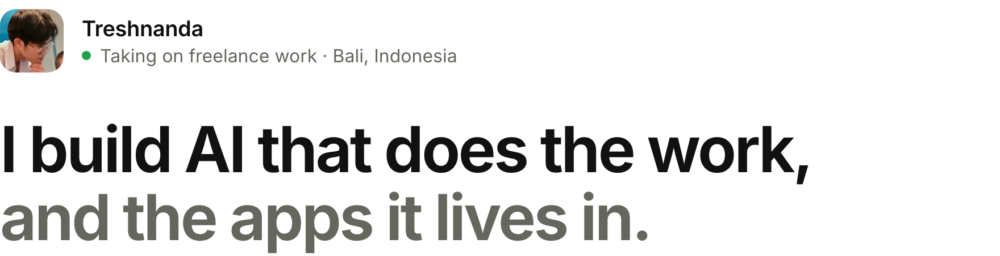
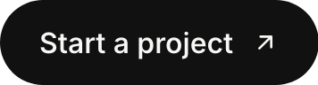
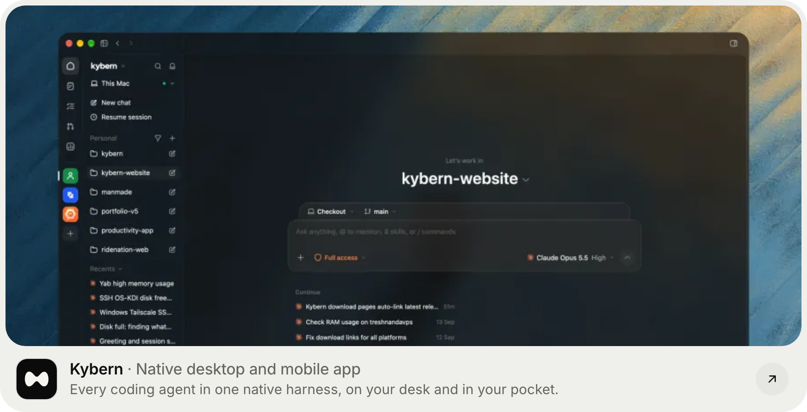
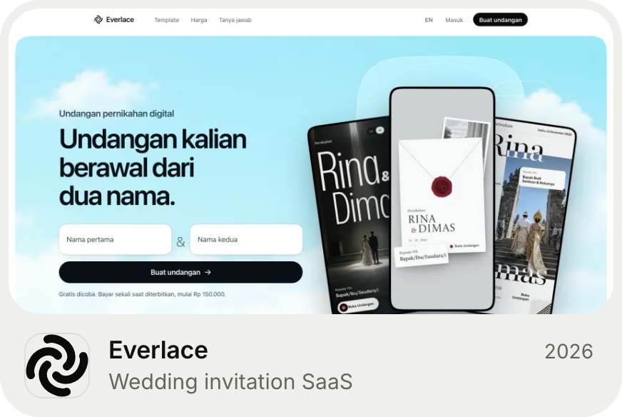
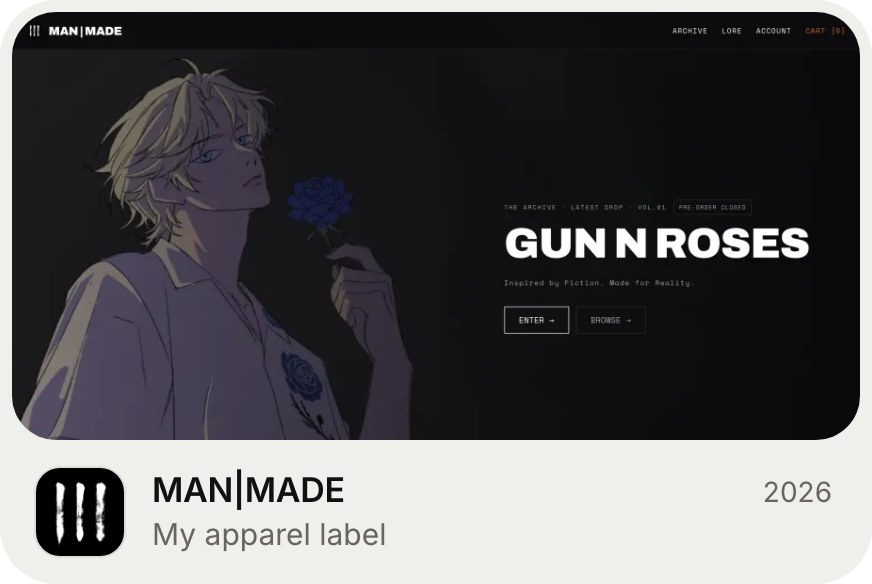
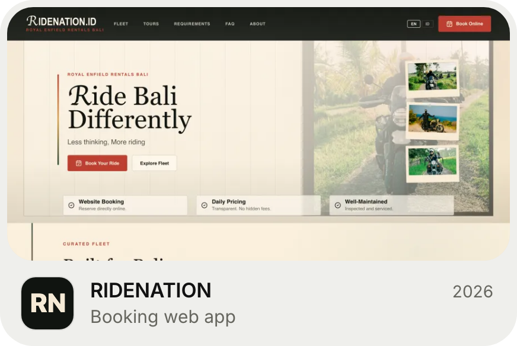
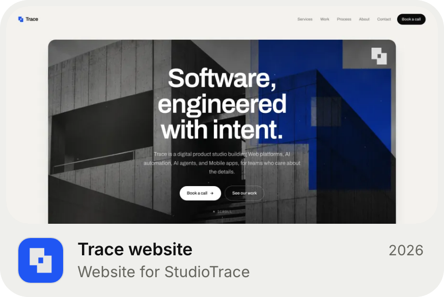
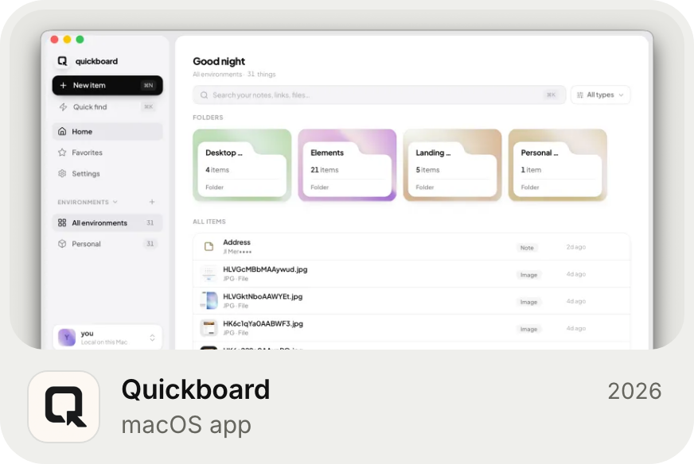
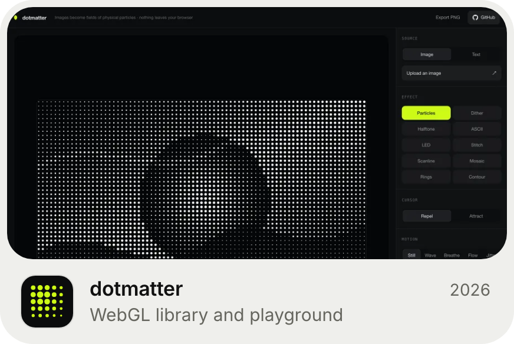
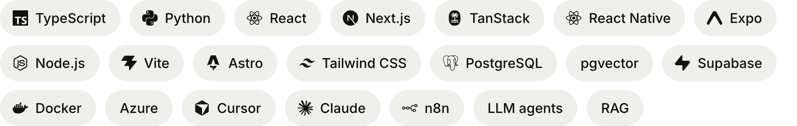

<picture>
  <source media="(prefers-color-scheme: dark)" srcset="assets/hero-dark.png">
  
</picture>

I’m Nanda, AI Systems Engineer at Kembar Digital. I design agents and automations that take repetitive work off people’s plates, then ship them as web, mobile and desktop apps. I co-founded [StudioTrace](https://studiotrace.cc), run [MAN|MADE](https://manmade.fit), my own apparel label, and help host builder events with [SpaceXAI Bali](https://luma.com/spacexai-bali).

<a href="mailto:treshnanda@gmail.com"><picture><source media="(prefers-color-scheme: dark)" srcset="assets/btn-start-dark.png"></picture></a>&nbsp;<a href="https://treshnanda.tech"><picture><source media="(prefers-color-scheme: dark)" srcset="assets/btn-site-dark.png"></picture></a>

 

<picture>
  <source media="(prefers-color-scheme: dark)" srcset="assets/h-work-dark.png">
  
</picture>

<a href="https://kybern.treshnanda.tech"><picture><source media="(prefers-color-scheme: dark)" srcset="assets/card-kybern-dark.png"></picture></a>
<a href="https://everlace.cc"><picture><source media="(prefers-color-scheme: dark)" srcset="assets/card-everlace-dark.png"></picture></a>
<a href="https://manmade.fit"><picture><source media="(prefers-color-scheme: dark)" srcset="assets/card-manmade-dark.png"></picture></a>
<a href="https://ridenationid.com"><picture><source media="(prefers-color-scheme: dark)" srcset="assets/card-ridenation-dark.png"></picture></a>
<a href="https://studiotrace.cc"><picture><source media="(prefers-color-scheme: dark)" srcset="assets/card-studiotrace-dark.png"></picture></a>
<a href="https://github.com/Tresnanda/quickboard"><picture><source media="(prefers-color-scheme: dark)" srcset="assets/card-quickboard-dark.png"></picture></a>
<a href="https://dotmatter.treshnanda.tech"><picture><source media="(prefers-color-scheme: dark)" srcset="assets/card-dotmatter-dark.png"></picture></a>

More on [treshnanda.tech](https://treshnanda.tech), plus open source like [git-standup](https://github.com/Tresnanda/git-standup), [envguard](https://github.com/Tresnanda/envguard) and [gpuix](https://github.com/Tresnanda/gpuix).

 

<picture>
  <source media="(prefers-color-scheme: dark)" srcset="assets/h-stack-dark.png">
  
</picture>

<picture>
  <source media="(prefers-color-scheme: dark)" srcset="assets/stack-dark.png">
  
</picture>

 

<picture>
  <source media="(prefers-color-scheme: dark)" srcset="assets/h-contact-dark.png">
  
</picture>

<a href="https://github.com/Tresnanda"><picture><source media="(prefers-color-scheme: dark)" srcset="assets/s-github-dark.png"></picture></a>
<a href="https://linkedin.com/in/treshnanda"><picture><source media="(prefers-color-scheme: dark)" srcset="assets/s-linkedin-dark.png"></picture></a>
<a href="https://x.com/treshpandaa"><picture><source media="(prefers-color-scheme: dark)" srcset="assets/s-x-dark.png"></picture></a>
<a href="https://instagram.com/treshnanda"><picture><source media="(prefers-color-scheme: dark)" srcset="assets/s-instagram-dark.png"></picture></a>
<a href="https://wa.me/6287852986638"><picture><source media="(prefers-color-scheme: dark)" srcset="assets/s-whatsapp-dark.png"></picture></a>
<a href="https://luma.com/user/usr-SYE86qqUlJUJvFy"><picture><source media="(prefers-color-scheme: dark)" srcset="assets/s-luma-dark.png"></picture></a>
